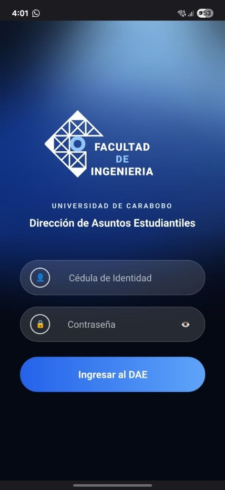

# AppDAE — Visor Estudiantil Móvil (FIUC)

Cliente móvil independiente y de código abierto (**GNU GPL v3**) desarrollado en **Qt / QML + C++** para facilitar el acceso desde Android a los servicios académicos de la **Dirección de Asuntos Estudiantiles (DAE)** de la Facultad de Ingeniería de la Universidad de Carabobo.

---

## Descargar APK (Sin Compilar)

Si eres estudiante y solo deseas instalar la aplicación en tu teléfono Android (`arm64-v8a`, Android 9.0 o superior):

- **[Descargar AppDAE v1.1 (APK)](https://github.com/Emmanuel726/AppDAE/releases/latest)**

> **Nota:** Para instalar el APK en Android, habilita *"Instalar aplicaciones de fuentes desconocidas"* en los ajustes del sistema.

---

## Captura de Pantalla

  

---

## Características Principales

- **Inicio de Sesión Directo y Biometría:** Autenticación cifrada directa contra `dae.ing.uc.edu.ve`, caché local por usuario y acceso rápido con huella dactilar nativa de Android.
- **Expediente Académico:** Consulta de promedio ponderado, aritmético, UC aprobadas y detalle por semestre (compatible con el formato clásico y el nuevo formato de historial).
- **Notas Transcritas:** Visualización de actas transcritas y asignaturas pendientes por transcribir.
- **Horario Asignado:** Malla horaria semanal, vista por días y detalle de cada materia (sección, aula, bloques y profesor).
- **Inscripción y Reporte:** Selección de asignaturas y secciones disponibles según RAP, validación de choques de bloques y consulta directa del reporte de solicitud de inscripción.
- **Servicios Académicos Integrados:**
  - **Visualizar RAP** (incluyendo materias habilitadas por Artículo 17).
  - **Oferta de Horarios** (Pensum 1997 y 2025) con buscador y profesores.
  - **Salones Disponibles** filtrados por día, hora y edificio.
  - **Mapa Interactivo de la Facultad**.
  - **Pensum de Estudios y Preguntas Frecuentes**.
  - **Reglamento de Evaluación**.
  - **Calendario Académico** y descarga de constancias/horarios en PDF.
  - **Carnet Universitario Virtual** y solicitud de **Cambio de Escuela**.
- **Tareas y Exámenes con Notificaciones:** Recordatorios locales programados mediante `AlarmManager` de Android (con selector de antelación o fecha/hora exacta en formato 12 h AM/PM).
- **Personalización:** Modo Claro, Oscuro, OLED o Sistema, paletas de colores con fondo animado Aurora y foto de perfil recortable.

---

## Compilar desde el Código Fuente

Consulta la guía completa de dependencias y comandos en **[REQUISITOS.md](REQUISITOS.md)**.

---

## Aviso Importante y Licencia

- **Proyecto Estudiantil Independiente:** Esta aplicación no está afiliada, respaldada ni administrada por la Dirección de Asuntos Estudiantiles (DAE), la Facultad de Ingeniería ni la Universidad de Carabobo.
- **Privacidad:** Tus credenciales viajan cifradas directamente desde tu dispositivo hacia los servidores oficiales del DAE. No existen servidores intermedios.
- **Licencia:** Distribuido bajo la licencia **GNU General Public License v3.0 (GPL v3)**. Consulta el archivo [LICENSE](LICENSE).
